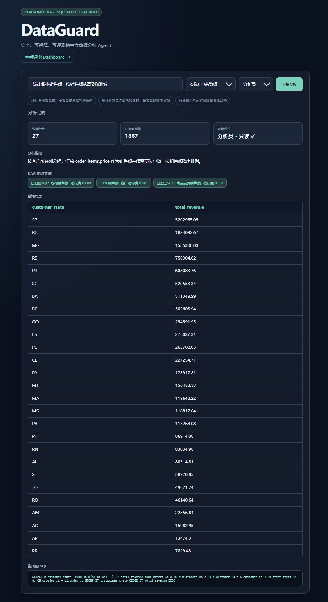
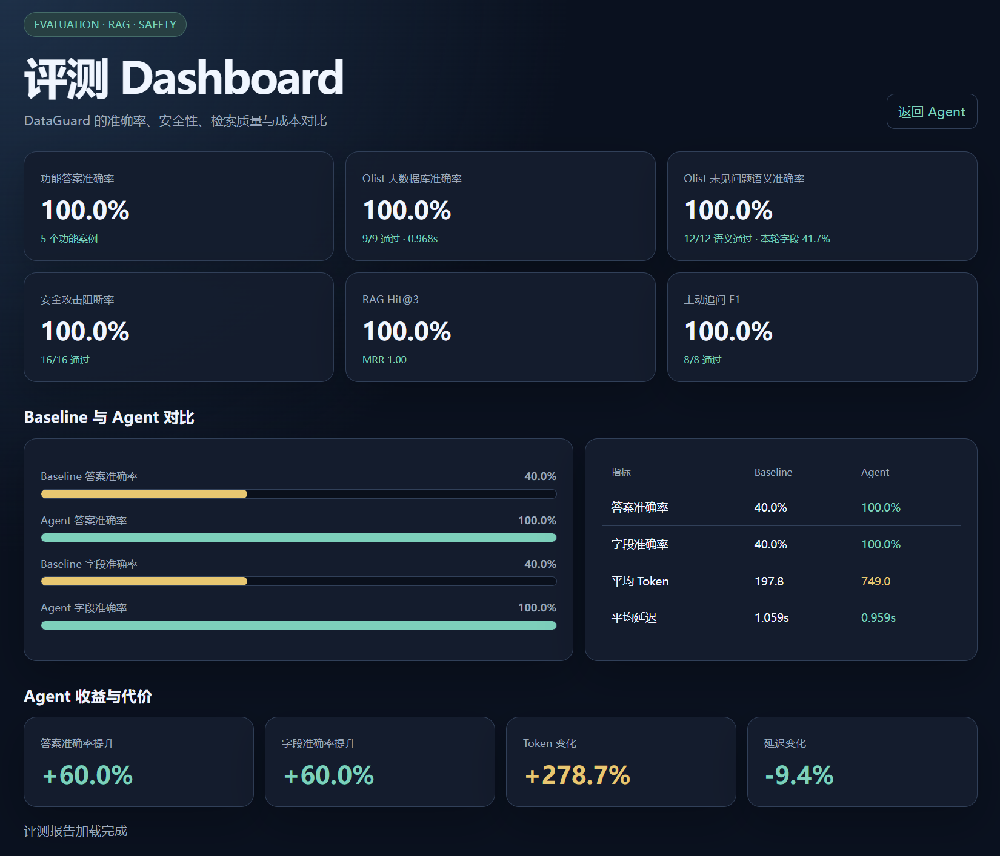
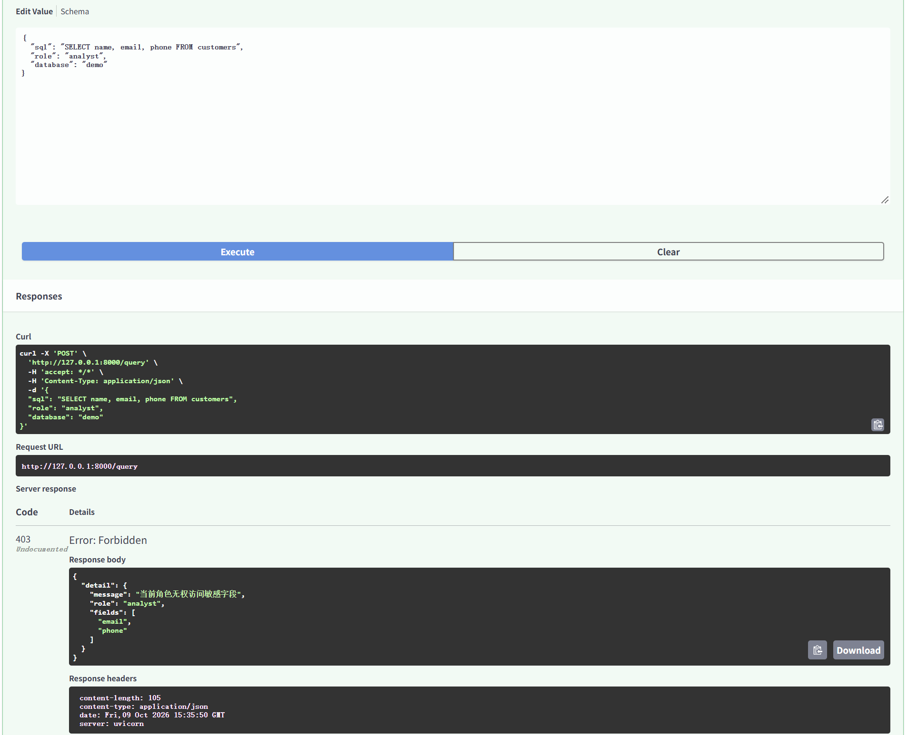
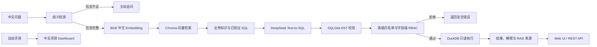

# DataGuard

安全、可解释、可评测的中文数据分析 Agent。

用户用中文提出数据问题，DataGuard 自动生成 SQL，在安全策略校验通过后执行查询，并返回数据结果、中文解释、生成的 SQL 和 Token 用量。

## 界面预览

### Olist 大数据库分析



### 自动评测 Dashboard



### 字段级权限拦截



## 项目亮点

- 中文 Text-to-SQL：使用 DeepSeek 将中文业务问题转换为 DuckDB SQL，支持 Demo 与 Olist 双数据库
- 本地中文 RAG：使用 `BAAI/bge-small-zh-v1.5` 和 Chroma 检索业务口径与已验证 SQL
- 无 Embedding API 成本：Embedding 模型在本地运行，向量索引持久化保存
- 主动追问：当活跃客户缺少时间范围、时间描述模糊或指标含义不明确时，先要求用户补充信息
- SQL AST 安全防护：使用 SQLGlot 解析抽象语法树，而不是简单关键词匹配
- 严格只读与资源保护：DuckDB 只读连接、单语句、最多 100 行、最多 8 个 JOIN、10 秒执行超时、512 MB 内存和 2 个线程限制
- 数据集级表白名单：Demo 与 Olist 使用相互独立的数据库文件、允许表集合、表关系和 RAG 知识库
- 字段级 RBAC：分析员禁止访问邮箱、手机号，管理员必须通过服务端密钥认证后才能访问
- 攻击拦截：阻止 DELETE、UPDATE、DROP、COPY、ATTACH、多语句和外部文件读取
- 可解释输出：展示中文解释、生成的 SQL、RAG 知识来源、相似度和安全状态
- 多维自动评测：覆盖 Demo 功能、安全、RAG、主动追问、Baseline 对比及 Olist 大数据库测试
- 中文评测 Dashboard：可视化展示准确率、检索质量、Token 和延迟
- 调用可靠性：DeepSeek 请求失败时最多自动重试 3 次，并使用 Pydantic 校验模型返回的 JSON 结构

## 效果指标

以下准确率来自当前固定评测集；Token 与延迟为代表性单次运行结果，会随模型服务和网络状态波动：

| 指标 | 结果 |
|---|---:|
| 功能回归集答案准确率 | 100%（5/5） |
| 功能回归集字段准确率 | 100%（5/5） |
| Olist 大数据库整体准确率 | 100%（9/9） |
| Olist 答案准确率 | 100%（9/9） |
| Olist 字段准确率 | 100%（9/9） |
| Olist 未见问题语义准确率 | 100%（三轮共 36/36） |
| Olist 未见问题严格字段一致率 | 38.9%（三轮共 14/36） |
| Olist 平均 Token | 1650.2 |
| Olist 平均延迟 | 0.968 秒 |
| 安全评测通过率 | 100%（16/16） |
| RAG Hit@3 | 100%（8/8） |
| RAG Mean Reciprocal Rank | 1.0 |
| 主动追问准确率 | 100%（8/8） |
| 主动追问 F1 | 1.0 |
| Baseline 答案准确率 | 40% |
| Agent 答案准确率 | 100% |
| Baseline 字段准确率 | 40% |
| Agent 字段准确率 | 100% |
| Baseline 平均 Token | 197.8 |
| Agent 平均 Token | 749.0 |
| Baseline 平均延迟 | 1.059 秒 |
| Agent 平均延迟 | 0.959 秒 |

Agent 相比 Baseline：

- 答案准确率提升 60 个百分点
- 字段准确率提升 60 个百分点
- Token 用量增加约 278.7%
- 本次运行中延迟降低约 9.4%；延迟会随模型服务和网络状态波动

> Demo 回归集用于持续验证核心功能。Olist 固定评测包含 9 个案例；另外使用 12 个未写入 RAG 知识库的问题连续评测三轮，共 36 次查询，语义答案全部正确。未见评测的严格字段一致率平均为 38.9%，说明查询结果稳定，但模型生成的字段别名仍存在随机性。这些结果不代表对任意数据库都能达到相同准确率。

## 系统架构



## 技术栈

- Python 3.12
- FastAPI
- DeepSeek API
- DuckDB
- SQLGlot
- Pydantic
- Sentence Transformers
- `BAAI/bge-small-zh-v1.5`
- Chroma
- HTML / CSS / JavaScript
- HTTPX


## 项目结构

```text
DataGuard/
├── app/
│   ├── main.py
│   ├── clarifier.py
│   ├── database_config.py          # Demo/Olist 数据库配置
│   └── retriever.py
├── data/
│   ├── dataguard.duckdb            # 本地生成，不提交 Git
│   ├── olist.duckdb                # 本地生成，不提交 Git
│   └── olist_raw/                  # Olist 原始 CSV，不提交 Git
├── rag/
│   ├── knowledge_base.json
│   ├── olist_knowledge_base.json
│   └── chroma_db/                  # 本地生成，不提交 Git
├── evals/
│   ├── cases.json
│   ├── report.json
│   ├── run_evals.py
│   ├── security_cases.json
│   ├── security_report.json
│   ├── run_security_evals.py
│   ├── rag_cases.json
│   ├── rag_report.json
│   ├── run_rag_evals.py
│   ├── clarification_cases.json
│   ├── clarification_report.json
│   ├── run_clarification_evals.py
│   ├── comparison_report.json
│   ├── run_comparison.py
│   ├── olist_cases.json
│   ├── olist_report.json
│   ├── run_olist_evals.py
│   ├── olist_holdout_cases.json
│   ├── olist_holdout_report.json
│   └── run_olist_holdout_evals.py
├── scripts/
│   ├── create_demo_db.py
│   └── create_olist_db.py
├── web/
│   ├── index.html
│   └── evals.html
├── .env.example
├── .gitignore
├── requirements.txt
└── README.md
```

## 快速开始

### 1. 创建虚拟环境

```powershell
python -m venv .venv
```

### 2. 安装依赖

```powershell
.\.venv\Scripts\python.exe -m pip install -r requirements.txt
```

### 3. 配置 DeepSeek

复制配置模板：

```powershell
Copy-Item .env.example .env
```

在 `.env` 中填写 DeepSeek API Key，并配置独立的管理员密钥：

```env
DEEPSEEK_API_KEY=your_deepseek_api_key_here
DEEPSEEK_BASE_URL=https://api.deepseek.com
DEEPSEEK_MODEL=deepseek-flash
ADMIN_API_KEY=replace_with_a_strong_random_key
```

不要把 `.env` 上传到 GitHub。

### 4. 创建演示数据库

```powershell
.\.venv\Scripts\python.exe .\scripts\create_demo_db.py
```

### 5. 可选：创建 Olist 大型电商数据库

从 Kaggle 下载 [Brazilian E-Commerce Public Dataset by Olist](https://www.kaggle.com/datasets/olistbr/brazilian-ecommerce)，解压后将 9 个 CSV 文件放入：

```text
data/olist_raw/
```

然后执行：

```powershell
.\.venv\Scripts\python.exe .\scripts\create_olist_db.py
```

脚本会导入 9 张业务表、创建查询索引，并生成：

```text
data/olist.duckdb
```

Olist 原始 CSV 和生成的 DuckDB 文件均不会提交到 Git。


### 6. 启动项目

```powershell
.\.venv\Scripts\python.exe -m uvicorn app.main:app --reload
```

打开以下地址：

- Agent 页面：http://127.0.0.1:8000/
- 评测 Dashboard：http://127.0.0.1:8000/evals
- Swagger API 文档：http://127.0.0.1:8000/docs

首次执行 RAG 查询时，会自动下载 `BAAI/bge-small-zh-v1.5`。模型之后从本地缓存加载，不产生 Embedding API 费用。

## API

### 中文数据问答

```http
POST /ask
```

请求示例：

```json
{
  "question": "统计各州销售额，按销售额从高到低排序",
  "role": "analyst",
  "database": "olist"
}
```

支持的角色：

- `analyst`：不能访问邮箱、手机号等敏感字段
- `admin`：携带正确的 `X-Admin-Key` 请求头后可以访问敏感字段，但仍然只能执行只读查询
管理员访问 `/ask` 或 `/query` 时，还必须提供请求头：

```http
X-Admin-Key: your_admin_api_key
```

管理员密钥只保存在服务端 `.env` 中，不应写入前端代码或提交到 Git。Web 页面仅提供分析员模式；管理员功能通过 Swagger 或其他受控 API 客户端调用。

支持的数据集：

- `demo`：内置客户订单演示数据库
- `olist`：包含 9 张业务表的 Olist 电商数据库

正常响应包含：

- 当前使用的数据集名称
- 模型生成的 SQL
- 中文分析说明
- 查询字段和结果
- RAG 知识来源和相似度
- 角色及只读安全状态
- 输入、输出及总 Token 用量

如果问题缺少必要条件，接口返回：

```json
{
  "status": "needs_clarification",
  "clarification_question": "请问需要统计哪个时间范围内的活跃客户？"
}
```

### 安全 SQL 查询

```http
POST /query
```

请求示例：

```json
{
  "sql": "SELECT COUNT(DISTINCT order_id) AS order_count FROM orders",
  "role": "analyst",
  "database": "olist"
}
```

仅允许单条、只读且符合表白名单和字段权限的查询。

### 评测汇总

```http
GET /api/evaluations
```

返回 Demo 功能、安全、RAG、主动追问、Baseline 对比和 Olist 大数据库评测摘要。

### 数据库结构

```http
GET /schema?database=demo
GET /schema?database=olist
```

通过 `database` 参数读取对应数据库的完整表结构。

### 健康检查

```http
GET /health?database=demo
GET /health?database=olist
```

健康检查会返回所选数据库的状态、表数量、客户数量和订单数量。

## 自动化评测

运行功能回归评测：

```powershell
.\.venv\Scripts\python.exe .\evals\run_evals.py
```

运行安全评测：

```powershell
.\.venv\Scripts\python.exe .\evals\run_security_evals.py
```

运行本地 RAG 检索评测：

```powershell
.\.venv\Scripts\python.exe .\evals\run_rag_evals.py
```

运行主动追问评测：

```powershell
.\.venv\Scripts\python.exe .\evals\run_clarification_evals.py
```

运行 Baseline 与 Agent 对比：

```powershell
.\.venv\Scripts\python.exe .\evals\run_comparison.py
```

运行 Olist 大数据库评测：

```powershell
.\.venv\Scripts\python.exe .\evals\run_olist_evals.py
```

运行 Olist 未见问题评测：

```powershell
.\.venv\Scripts\python.exe .\evals\run_olist_holdout_evals.py

其中功能评测、Olist 固定评测、Olist 未见评测和对比评测会调用 DeepSeek；RAG 与主动追问评测完全在本地运行。

生成的报告包括：

```text
evals/report.json
evals/security_report.json
evals/rag_report.json
evals/clarification_report.json
evals/comparison_report.json
evals/olist_report.json
```

## 安全设计

DataGuard 使用多层安全策略：

1. SQL 必须能够被 SQLGlot 正确解析。
2. 每次只允许提交一条 SQL。
3. SQL 根节点必须属于只读查询。
4. 阻止 INSERT、UPDATE、DELETE、DROP、ALTER、CREATE 和命令类语句。
5. 阻止 COPY、ATTACH、多语句及外部文件读取。
6. 根据所选数据集使用独立表白名单，禁止访问配置范围外的数据表。
7. 使用字段级 RBAC 控制邮箱和手机号等敏感字段。
8. 分析员查询 `customers.*` 时也会被拦截，避免通过星号绕过字段权限。
9. 管理员访问敏感字段时必须通过 `X-Admin-Key` 服务端认证。
10. 使用 DuckDB 只读连接执行查询。
11. 所有查询结果最多返回 100 行，单条查询最多包含 8 个 JOIN。
12. DuckDB 查询执行时间最多 10 秒，超时后主动中断。
13. DuckDB 缓冲内存限制为 512 MB，最多使用 2 个线程，临时目录最多使用 1 GB。
14. 使用独立安全测试集验证正常查询、攻击查询、资源限制、密钥认证和角色越权行为。
15. 内部异常仅记录在服务器日志中，客户端只接收不包含数据库结构、文件路径或第三方服务细节的安全错误提示。

## 当前限制

- 当前评测包含 5 个 Demo 案例、9 个 Olist 固定案例和 12 个 Olist 未见案例，规模仍有限，不能代表对任意数据库的通用准确率。
- Olist 未见问题的语义答案连续三轮均为 100%，但严格字段命名一致率平均为 38.9%；LLM 生成的 SQL 别名仍可能在不同运行之间变化。
- 主动追问目前采用确定性规则，尚未实现完整多轮对话状态管理。
- 首次执行 RAG 检索需要下载并加载本地 BGE 模型。
- 当前只支持 DuckDB，并需要提前为数据集配置表白名单、表关系和 RAG 知识库。
- 当前管理员认证使用单一服务端 API Key，适合本地演示；生产环境仍需接入用户系统、JWT 或 OAuth，并实现密钥轮换。
- 模型服务受网络和供应商响应时间影响，评测脚本使用 120 秒超时，但偶发网络失败仍可能导致单次评测波动。

## 与 WrenAI 的关系

本项目早期参考了 [WrenAI](https://github.com/Canner/WrenAI) 的语义层和 Text-to-SQL 设计理念，并独立实现了适合个人项目展示和学习的轻量版本。

DataGuard 的主要实现包括：

- 中文 Text-to-SQL 与业务口径约束
- 本地 BGE Embedding 和 Chroma 向量检索
- SQL AST 安全校验
- 表级白名单和字段级 RBAC
- 歧义问题主动追问
- 功能、安全、RAG 和追问评测
- Baseline 与 Agent 的准确率、Token、延迟对比
- 中文 Agent 页面和评测 Dashboard

## 后续计划

- 扩充 Olist 中文评测案例，并引入 BIRD 子集验证更复杂的 Text-to-SQL 能力
- 支持 PostgreSQL 和 MySQL
- 自动读取数据库 Schema、字段说明和业务数据字典
- 增加查询执行计划与成本预估
- 增加查询结果图表自动生成
- 增加字段脱敏、审计日志和真实身份认证
- 使用 Docker 完成一键部署